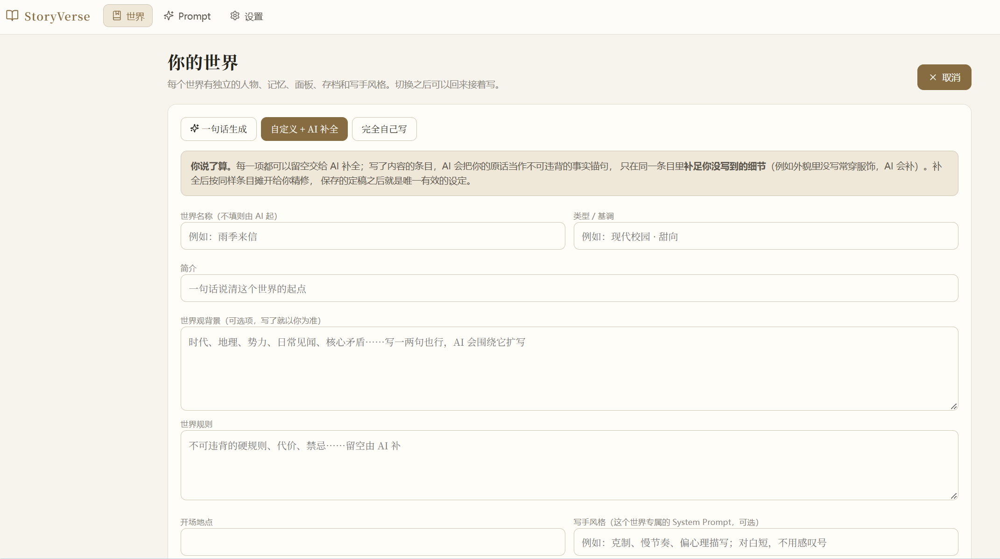
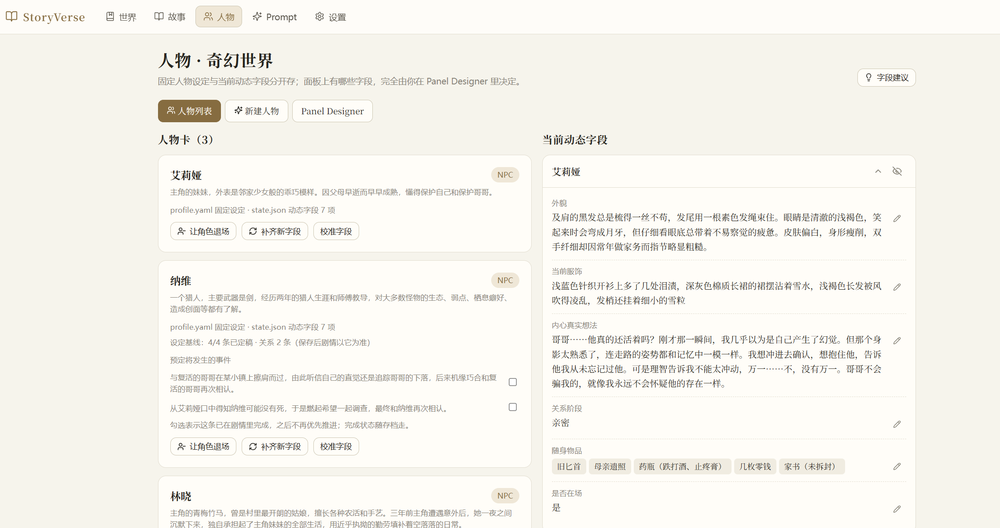
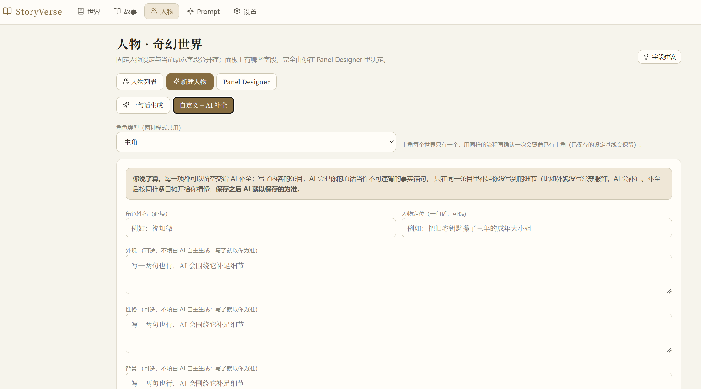
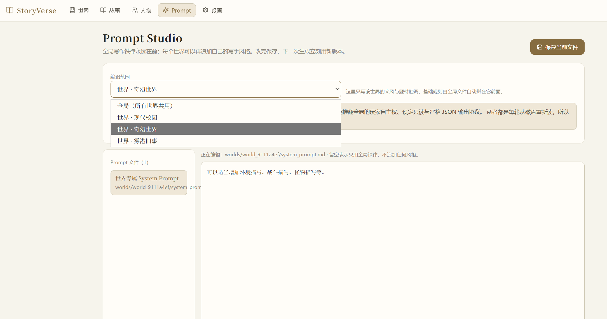
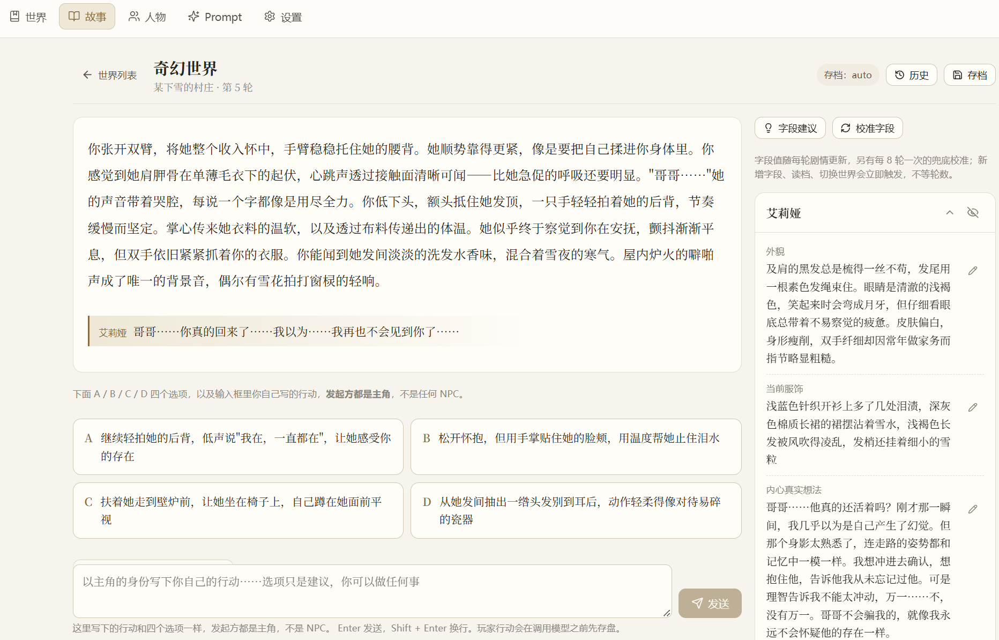
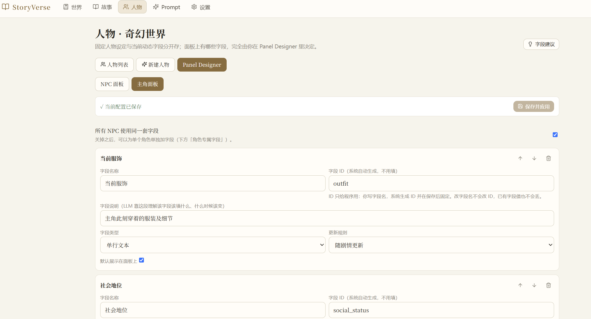

# StoryVerse

本地运行的 AI 互动叙事引擎：管理多个独立世界观、世界内人物卡、人物关系与长期剧情记忆，每轮由大模型生成一段小说正文，提供用户四个选项+一个自定义，系统每轮更新人物字段、记忆与存档。

**人物相关字段完全自定义**：人物面板常驻，面板上字段由用户决定。全部写在每个世界的 `ui/panels.yaml` 里。比如：魔力等级、随身道具等等。

---

## 环境要求

| 组件      | 版本        | 说明                           |
| ------- | --------- | ---------------------------- |
| Python  | 3.11 以上   | 后端 FastAPI                   |
| Node.js | 18 以上     | 前端 Vite + React + TypeScript |
| npm     | 随 Node 安装 | 包管理器                         |
| 本地推理服务  | 自装        | 不装启动Mock mode，无游玩体验          |


---

## 最快开始
双击项目根目录的 **`start.bat`**，自动：

1. 创建 `backend/.venv` 虚拟环境（把项目依赖和 system Python 隔开）；
2. 安装 `backend/requirements.txt`；
3. 首次运行时安装前端 `npm` 依赖；
4. 在 8000 端口启动后端、5173 端口启动前端。

浏览器打开 **http://127.0.0.1:5173** 。首页会显示自带的 Demo 世界「雾港旧事」

**项目初始默认是 Mock Mode**，不需要先配任何模型。**模型服务没启动时，请在设置页把 Mock Mode 勾回来**。

## 用手机访问电脑上的项目
双击 **`start_lan.bat`**，然后在命令行里运行 `ipconfig` 找到电脑的 IPv4 地址（形如 `<你的电脑IP>`），手机连同一个 Wi-Fi，浏览器打开：

```
http://<你的电脑IP>:5173
```

安全设计：局域网模式下**只有前端开发服务器**监听 `0.0.0.0`，后端仍只监听 `127.0.0.1`，由前端代理转发 `/api`。请只在可信的家庭 Wi-Fi 下使用，**不要做公网端口映射、不要暴露到互联网**。

PWA：前端带 `manifest.webmanifest` 和图标，手机浏览器里「添加到主屏幕」即可像 App 一样全屏打开（MVP 只做基础可安装配置，没有离线缓存）。

## 文件结构

```
StoryVerse/
├── config/
│   ├── system_prompt.md          ← 全局 System Prompt
│   ├── generation_config.yaml    ← 生成参数与默认 Provider 配置
│   ├── settings.yaml             ← 你在设置页保存的配置（含 API Key，首次保存后生成）
│   └── prompts/                  ← 各任务 Prompt，每个任务一个文件
├── worlds/
│   ├── world_demo/               ← 自带的完整 Demo 世界
│   └── {world_id}/               ← 之后每建一个世界多一个独立目录
│       ├── world.yaml            ← 世界名称、简介、类型、开场资料
│       ├── system_prompt.md      ← 这个世界专属的写手风格（追加在全局铁律之后）
│       ├── setting.md            ← 世界观背景
│       ├── rules.md              ← 世界规则
│       ├── ui/panels.yaml        ← 人物面板字段定义（Panel Designer 改的就是它）
│       ├── characters/
│       │   ├── protagonist/{profile.yaml, state.json}
│       │   └── npcs/{npc_001}/{profile.yaml, state.json}
│       ├── locations/ lore/      ← 地点与补充设定（Markdown）
│       ├── state/
│       │   ├── current.json      ← 当前轮次、地点、存档 ID、校准计数、已完成的预定事件
│       │   ├── relationships.json
│       │   └── field_suggestions.json
│       ├── memory/
│       │   ├── summary.md        ← 剧情摘要
│       │   ├── timeline.jsonl    ← 事件时间线（每行一条 JSON，只追加）
│       │   └── history.jsonl     ← 每轮对话
│       └── saves/{save_id}/      ← 每个存档一份完整快照
└── frontend/  backend/  docs/
```

## 使用指南：
## 1.新建世界：一句话AI全补全或手搓+AI补细节



---
## 2. 创建人物：
自定义：
人物背景+人物间关系+已发生事件+未发生事件，
AI会优先抽取玩家已写的未发生事件演绎，可以提前写下自己希望发生的事件。





---
## 3.改 System Prompt：全局铁律 + 每个世界一个写手



**分层规则**：`config/system_prompt.md` 是全局基础写作规则（视角、Show Don't Tell、玩家自主权、设定只读、严格 JSON 输出），**永远拼在最前面**；`worlds/{world_id}/system_prompt.md` 只写这个世界专属的**文风**（节奏、用词、题材腔调、篇幅偏好），追加在后面，不能推翻全局铁律。不同世界因此可以有完全不同的写手。世界文件为空时只有全局生效。

**改了怎么同步（正在游戏里也一样）**：

| 改了什么 | 什么时候生效 | 影响范围 |
|---|---|---|
| 全局 `system_prompt` | **下一次生成立即生效**，不用结束游戏、不用重启、不用手动同步 | 所有世界（包括所有标签页） |
| 某个世界的 `system_prompt.md` | **该世界下一轮生成立即生效**，不用退出游戏 | 只有这个世界 |
| 已经发出、正在等模型返回的那一轮 | 不受影响，用的是发出那一刻拼好的文本 | — |

---
## 4.进入世界，正式开始故事
 正式进入故事后，AI 会根据当前世界观、人物设定和已经发生的事件生成剧情。每轮4选项+玩家自定义选项。模型将围绕玩家选项继续生成故事。


 
---
## 5. Panel Designer：完全自定义人物字段

进入一个世界 → 左侧「人物」→ **Panel Designer** 标签页。



### 能做什么

- 分别配置**主角面板**和 **NPC 面板**（不同世界可以用完全不同的一套字段）。
- 新增任意字段、改名称、改说明、删除、上下调整顺序、设默认是否展示、设类型、设更新规则。
- 保存后前端面板**立刻重新渲染**，若这次新增了字段，后端会**立刻按已有剧情为所有角色补齐初始值**。
- 游戏主页的人物面板也可以直接点字段值手动修改。